<!-- ══════════════════════════════════════════════════════════════════════════ -->
<!--  Every block below is an animated SVG in /cards, drawn from real data by  -->
<!--  scripts/render_readme_cards.py and redrawn daily by                       -->
<!--  .github/workflows/readme-cards.yml. A README cannot run scripts — the art -->
<!--  is in the images, the layout is this markdown.                            -->
<!-- ══════════════════════════════════════════════════════════════════════════ -->

<picture>
  <source media="(prefers-color-scheme: dark)" srcset="./cards/hero-dark.svg">
  
</picture>

### whoami

Full-stack developer at **Patoliya Infotech**, leading backend on an active product: API design, schema decisions, code review. [**Nirvitta**](https://www.nirvitta.in) — WhatsApp-first commerce, live and taking orders — and the AI systems below are mine end to end.

The method is AI-native: I write the spec, delegate implementation to agents, then read every merged diff like my name is on it. Because it is.

> strong validation · correct failure modes · typed end to end · fast without shipping mess

<picture>
  <source media="(prefers-color-scheme: dark)" srcset="./cards/graph-dark.svg">
  
</picture>

<picture>
  <source media="(prefers-color-scheme: dark)" srcset="./cards/activity-dark.svg">
  
</picture>

<a href="https://www.prathampatel.in/#projects"><picture><source media="(prefers-color-scheme: dark)" srcset="./cards/tile-build-dark.svg"></picture></a><a href="https://www.prathampatel.in/#workflow"><picture><source media="(prefers-color-scheme: dark)" srcset="./cards/tile-craft-dark.svg"></picture></a><a href="https://www.prathampatel.in/#now"><picture><source media="(prefers-color-scheme: dark)" srcset="./cards/tile-learn-dark.svg"></picture></a>

### selected work

<a href="https://www.prathampatel.in/#projects"><picture><source media="(prefers-color-scheme: dark)" srcset="./cards/proj-shiftora-dark.svg"></picture></a><a href="https://www.prathampatel.in/#projects"><picture><source media="(prefers-color-scheme: dark)" srcset="./cards/proj-intervue-dark.svg"></picture></a><a href="https://www.prathampatel.in/#projects"><picture><source media="(prefers-color-scheme: dark)" srcset="./cards/proj-syncstream-dark.svg"></picture></a>

### toolkit

```
frontend     React · Next.js · Tailwind · shadcn/ui · GSAP · Framer Motion
backend      Node.js · Express · NestJS · REST · Socket.IO · RBAC
data         PostgreSQL · Prisma · Drizzle · Redis · MongoDB · Neon · Supabase
ai-native    agentic workflows · MCP tool design · RAG · evals · prompt engineering
ai-stack     Cursor · Claude Code · Codex · OpenAI · Anthropic · pgvector · BullMQ
infra        Docker · AWS · Nginx · GitHub Actions · Vercel
craft        system design · CI/CD · validation at boundaries · test-first review
```

### connect

[linkedin](https://www.linkedin.com/in/prathamm27) &nbsp;·&nbsp; [prathampatel5553@gmail.com](mailto:prathampatel5553@gmail.com) &nbsp;·&nbsp; [x](https://x.com/Pratham68410619) &nbsp;·&nbsp; [resume](https://www.prathampatel.in/Pratham_Patel.pdf) &nbsp;·&nbsp; [prathampatel.in](https://www.prathampatel.in)

---

<sub>shipped with agents, reviewed by a human. The cards above are regenerated every morning from my contribution calendar — if a number looks wrong, that's the human's fault.</sub>
