<!-- ══════════════════════════════════════════════════════════════════════════ -->
<!--  Every block below is an animated SVG in /cards, drawn from real data by  -->
<!--  scripts/render_readme_cards.py and redrawn daily by                       -->
<!--  .github/workflows/readme-cards.yml. A README cannot run scripts — the art -->
<!--  is in the images, the layout is this markdown.                            -->
<!-- ══════════════════════════════════════════════════════════════════════════ -->

<picture>
  <source media="(prefers-color-scheme: dark)" srcset="./cards/hero-dark.svg">
  
</picture>

### whoami

Full-stack developer at **Patoliya Infotech**, leading backend on an active product: API design, schema decisions, code review. The rest of the day is AI-native development — I write the spec, delegate the implementation to agents (Cursor, Claude Code, Codex), then read every merged diff like my name is on it. Because it is.

> strong validation · correct failure modes · typed end to end · fast without shipping mess

<picture>
  <source media="(prefers-color-scheme: dark)" srcset="./cards/graph-dark.svg">
  
</picture>

<picture>
  <source media="(prefers-color-scheme: dark)" srcset="./cards/activity-dark.svg">
  
</picture>

<a href="https://www.prathampatel.in/#projects"></a><a href="https://www.prathampatel.in/#workflow"></a><a href="https://www.prathampatel.in/#now"></a>

### selected work

| | project | what it is | stack |
|:--:|:---|:---|:---|
| 01 | [**nirvitta**](https://www.nirvitta.in) | WhatsApp-first fashion commerce — conversational checkout instead of a cart, Payload CMS 3, migrations in the build | next · payload · neon · gsap |
| 02 | **intervue-ai** | multi-tenant AI interview SaaS — permission-checked MCP tools, AI/HUMAN/SYSTEM audit trail, dual-model scoring that escalates disagreement | nest · prisma · mcp · bullmq |
| 03 | [**portfolio**](https://www.prathampatel.in) | the site these cards are cut from — paper, ink, one blue | next 16 · tailwind 4 · gsap |

### toolkit

```
frontend    React · Next.js · Tailwind · shadcn/ui · GSAP · Framer Motion
backend     Node.js · Express · NestJS · REST · Socket.IO · RBAC
data        PostgreSQL · Prisma · Redis · MongoDB · Neon · Supabase
ai-native   Cursor · Claude Code · Codex · MCP · OpenAI API · RAG
infra       Docker · AWS · Nginx · GitHub Actions · Vercel
craft       system design · evals · CI/CD · validation at boundaries
```

<a href="https://github.com/Shinzo27/LearnLive"></a><a href="https://github.com/Shinzo27/Grocery-Store"></a><a href="https://github.com/Shinzo27/DevTrack"></a>

### connect

[linkedin](https://www.linkedin.com/in/prathamm27) &nbsp;·&nbsp; [prathampatel5553@gmail.com](mailto:prathampatel5553@gmail.com) &nbsp;·&nbsp; [x](https://x.com/Pratham68410619) &nbsp;·&nbsp; [resume](https://www.prathampatel.in/Pratham_Patel.pdf) &nbsp;·&nbsp; [prathampatel.in](https://www.prathampatel.in)

---

<sub>shipped with agents, reviewed by a human. The cards above are regenerated every morning from my contribution calendar — if a number looks wrong, that's the human's fault.</sub>
